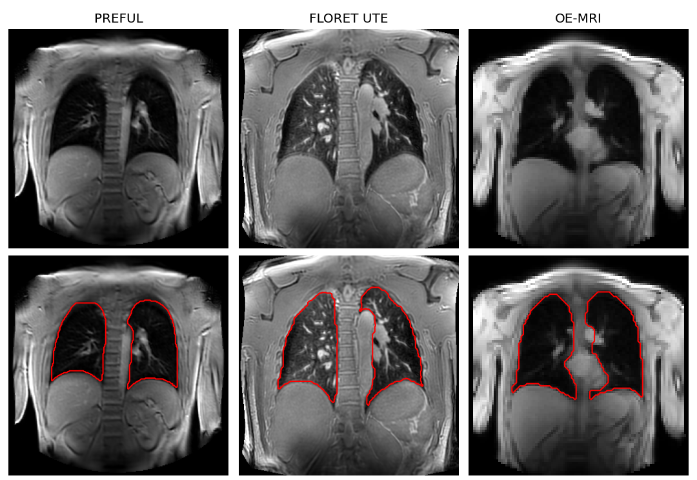

# Dynamic Lung Segmentation with nnU-Net

## Aim

Automated lung segmentation for 2D coronal proton lung MRI that works across acquisitions and pathologies. A single 2D nnU-Net was trained on oxygen-enhanced MRI (OE-MRI), PREFUL and FLORET UTE images from healthy volunteers and participants with long COVID and GLILD.

Reference masks were manually refined following an annotation protocol developed with two thoracic radiologists, each with over 15 years of experience in thoracic imaging.


## Results

Dice similarity coefficient (DSC) on a held-out test set of 91 images that were not used in training.

| Acquisition | Participants | Slices | Mean DSC |
|---|---|---|---|
| PREFUL | 3 healthy, 3 long COVID, 1 GLILD | 60 | 0.967 |
| OE-MRI | 2 long COVID | 24 | 0.963 |
| FLORET UTE | 1 healthy | 7 | 0.953 |


## Usage

Requirements: Python 3.10 or later and [PyTorch](https://pytorch.org/get-started/locally/). A GPU is not required.

1. Clone the repository (or Code > Download ZIP).

    ```bash
    git clone https://github.com/bensii8511/Dynamic-Lung-Segmentation-nnU-Net.git
    cd Dynamic-Lung-Segmentation-nnU-Net
    ```

2. Install nnU-Net.

    ```bash
    pip install nnunetv2==2.6.2
    ```

3. Set `nnUNet_results` to any empty folder. nnU-Net stores the model there.

    ```bash
    export nnUNet_results="/path/to/nnUNet_results"          # Linux / macOS
    $env:nnUNet_results = "C:\path\to\nnUNet_results"        # Windows PowerShell
    ```

4. Install the trained model from `weights/`.

    ```bash
    nnUNetv2_install_pretrained_model_from_zip weights/PREFUL_OEMRI_lung_nnunet_v1.zip
    ```

5. Run the model. `-i` is the folder of images, `-o` is where the masks are written.

    ```bash
    nnUNetv2_predict -i examples/input -o my_output -d 8511 -c 2d -f all
    ```

    Add `-device cpu` if no GPU is available. For the example images the output should match `examples/expected_output`. nnU-Net prints a warning that `nnUNet_raw` and `nnUNet_preprocessed` are not set, which can be ignored for prediction.



### Input format

Images must be NIfTI, one 2D coronal slice per file, named as below. The `_0000` suffix is required by nnU-Net.

```
input/case_0000_0000.nii.gz    ->    output/case_0000.nii.gz
input/case_0001_0000.nii.gz    ->    output/case_0001.nii.gz
```

For a dynamic series each time frame is a separate file, and for a 3D volume each coronal slice is a separate file. The voxel spacing in the NIfTI header must be correct because nnU-Net resamples with it. Image orientation should match the examples (`case_0000`, `case_0001` are PREFUL, `case_0002`, `case_0003` are FLORET UTE, `case_0004`, `case_0005` are OE-MRI).

The output mask is 0 for background and 1 for lung.

## Data

The model was trained on 401 2D images from 12 participants, all acquired at 3T.

| | OE-MRI | PREFUL | FLORET UTE |
|---|---|---|---|
| Scanner | Philips Ingenia | Philips Ingenia | Philips Achieva |
| Sequence | 2D SPGR | 2D SPGR | 3D spiral UTE |
| Acquisition | Dynamic, free breathing | Dynamic, free breathing | Static |
| In-plane resolution | 4.7 × 4.7 mm | 2 × 2 mm | 1 × 1 mm |
| Slice thickness | 10 mm | 15 mm | 1 mm |
| Matrix | 96 × 96 | 240 × 240 | 384 × 384 × 384 |

For OE-MRI and PREFUL, frames were selected randomly across the time series to cover the breathing cycle. FLORET UTE volumes were reformatted into coronal slices from posterior to anterior.

Masks were generated in 3D Slicer by intensity thresholding followed by manual refinement. The aorta, heart, trachea and main bronchi were excluded. Small pulmonary vessels within the lung were included.


The training and test data are available upon request (bensii125@gmail.com).

## Training

nnU-Net v2 with the default 2D configuration (patch size 96 × 96, batch size 20, 1000 epochs), trained on all 401 images using `-f all`. Training took about 1 h 42 min on one RTX 5090.


To retrain with data in nnU-Net format:

```bash
nnUNetv2_plan_and_preprocess -d 8511 --verify_dataset_integrity
nnUNetv2_train 8511 2d all
```

## Limitations

The model has only been tested on data from one site. FLORET UTE is represented by one participant in training and one in testing. Each slice is segmented independently, and performance is slightly lower on the most anterior and posterior slices. For research use only.

## Acknowledgements

This work was supervised by Dr Mina Kim and Dr Yohn Taylor, UCL Department of Medical Physics and Biomedical Engineering. The model was built with [nnU-Net](https://github.com/MIC-DKFZ/nnUNet).

## Contact

Ben Sii, bensii125@gmail.com
