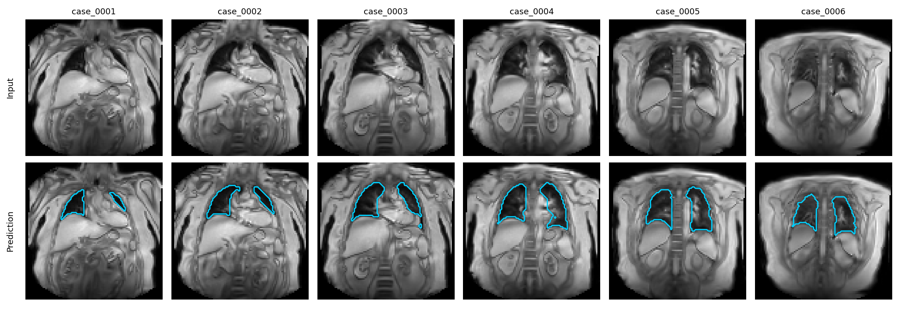

# Dynamic Lung Segmentation with nnU-Net

2D nnU-Net model for lung segmentation in coronal proton lung MRI. Trained on OE-MRI, 2D PREFUL and FLORET UTE images from healthy volunteers and patients (long COVID, GLILD).

Built during my MSc project at UCL (Medical Physics and Biomedical Engineering), where it is used to get the respiratory waveform for PREFUL automatically from the segmented lung area in each frame, instead of drawing an ROI by hand.

Reference masks were manually refined following an annotation protocol developed with two thoracic radiologists, each with over 15 years of experience.


## What's in this repo

- `weights/` – the trained model (`PREFUL_OEMRI_lung_nnunet_v1.zip`, 58 MB)
- `examples/` – six test images and the masks the model should give for them
- `docs/` – figures

The training and test images are available upon request: bensii125@gmail.com

## How to run

You need Python 3.10+ and PyTorch ([install guide](https://pytorch.org/get-started/locally/)). A GPU is not needed, CPU is fast enough.

**1. Download this repo**

```bash
git clone https://github.com/bensii8511/Dynamic-Lung-Segmentation-nnU-Net.git
```

```bash
cd Dynamic-Lung-Segmentation-nnU-Net
```

Or use the green **Code** button → **Download ZIP**.

**2. Install nnU-Net**

```bash
pip install nnunetv2==2.6.2
```

**3. Choose a folder for nnU-Net to store the model in**

Linux / macOS:

```bash
export nnUNet_results="/path/to/nnUNet_results"
```

Windows (PowerShell):

```powershell
$env:nnUNet_results = "C:\path\to\nnUNet_results"
```

**4. Install the weights**

```bash
nnUNetv2_install_pretrained_model_from_zip weights/PREFUL_OEMRI_lung_nnunet_v1.zip
```

**5. Segment the example images**

```bash
nnUNetv2_predict -i examples/input -o my_output -d 8511 -c 2d -f all
```

Add `-device cpu` if you don't have a GPU. The masks in `my_output` should be the same as the ones in `examples/expected_output`.

nnU-Net will warn that `nnUNet_raw` and `nnUNet_preprocessed` are not set. This is fine, they are only needed for training.



## Running on your own data

Put your images in one folder as NIfTI files, one 2D coronal slice per file, named like this:

```
case_0001_0000.nii.gz
case_0002_0000.nii.gz
```

The `_0000` at the end is required by nnU-Net. Then run the same predict command with `-i` pointing to your folder.

- Dynamic series (PREFUL, OE-MRI): save each time frame as a separate file.
- 3D volumes (UTE): save each coronal slice as a separate file.
- Check the voxel spacing in the NIfTI header is right. nnU-Net handles resampling and intensity normalisation itself.

The output is a mask with the same size as the input: 0 = background, 1 = lung.

For a dynamic series, counting the lung voxels in each frame gives the respiratory waveform:


## Dataset

401 2D images from 12 participants (healthy volunteers, long COVID, GLILD), all at 3T.

| | OE-MRI | PREFUL | FLORET UTE |
|---|---|---|---|
| Scanner | Philips Ingenia | Philips Ingenia | Philips Achieva |
| Sequence | 2D SPGR | 2D SPGR | 3D spiral UTE |
| Acquisition | Dynamic, free breathing | Dynamic, free breathing | Static |
| In-plane resolution | 4.7 × 4.7 mm | 2 × 2 mm | 1 × 1 mm |
| Slice thickness | 10 mm | 15 mm | 1 mm |
| Matrix | 96 × 96 | 240 × 240 | 384 × 384 × 384 |
| Field of view | 450 × 450 mm | 480 × 480 mm | 384 × 384 × 384 mm |

For OE-MRI and PREFUL, frames were picked randomly across the time series so the whole breathing cycle is covered. The FLORET UTE volumes were split into coronal slices from posterior to anterior. The healthy volunteer OE-MRI data are from Kim et al. (2024).

### Masks

Masks were drawn in 3D Slicer: thresholding first, then manual correction. The annotation protocol was developed with two thoracic radiologists, each with over 15 years of experience in thoracic imaging:

- aorta excluded
- small pulmonary arteries and veins included
- smooth contour at the lung–heart boundary, heart excluded, larger pulmonary vessels kept
- trachea and main bronchi excluded


## Training

nnU-Net v2, `2d` configuration, default trainer and plans. Patch size 96 × 96, batch size 20, Dice + cross-entropy loss, 1000 epochs, trained on all 401 images (`-f all`). About 1 h 42 min on an RTX 5090.

To retrain on your own data in [nnU-Net format](https://github.com/MIC-DKFZ/nnUNet/blob/master/documentation/dataset_format.md):

```bash
nnUNetv2_plan_and_preprocess -d 8511 --verify_dataset_integrity
```

```bash
nnUNetv2_train 8511 2d all
```

## Results

### Segmentation

Tested on 91 images that were not used for training.

| Acquisition | Participants | Slices | Mean DSC | Per-slice SD |
|---|---|---|---|---|
| PREFUL | 3 healthy, 3 long COVID, 1 GLILD | 60 | 0.967 | 0.007 |
| OE-MRI | 2 long COVID | 24 | 0.963 | 0.012 |
| FLORET UTE | 1 healthy | 7 | 0.953 | 0.010 |


### PREFUL waveform

The model was run on every frame of 2D PREFUL scans from 18 participants with cystic fibrosis (not seen in training), and the lung voxel count was used as the respiratory waveform. PREFUL VDP from this was compared with ¹²⁹Xe MRI VDP, next to three manually placed ROIs.

| Waveform | Pearson r | Bias (%) | 95% limits of agreement (%) |
|---|---|---|---|
| Manual ROI 1 | 0.78 | 1.12 | −7.17 to 9.40 |
| Manual ROI 2 | 0.82 | 0.43 | −6.98 to 7.83 |
| Manual ROI 3 | 0.76 | 1.75 | −6.66 to 10.16 |
| Automated (this model) | 0.77 | 0.65 | −7.63 to 8.93 |

The automated waveform gives similar agreement with ¹²⁹Xe to manual ROI placement.

## Limitations

- Only tested on internal data from one site.
- FLORET UTE: one healthy participant in training and one in testing.
- Cystic fibrosis was not in the training data. It still worked, but was slightly worse on the most posterior and anterior slices.
- 2D model, so every slice and frame is segmented on its own.
- For research only, not for clinical use. Check the masks before using them.

## Citation

> Sii BZH. Deep Learning Lung Segmentation for Automated Waveform Extraction in 2D PREFUL MRI. MSc thesis, University College London; 2026.

Please also cite nnU-Net:

> Isensee F, Jaeger PF, Kohl SAA, Petersen J, Maier-Hein KH. nnU-Net: a self-configuring method for deep learning-based biomedical image segmentation. Nat Methods. 2021;18(2):203–211.

OE-MRI data:

> Kim M, Naish JH, Needleman SH, Tibiletti M, Taylor Y, O'Connor JPB, et al. Feasibility of dynamic T2*-based oxygen-enhanced lung MRI at 3T. Magn Reson Med. 2024;91(3):972–86.

## Acknowledgements

Supervised by Dr Mina Kim and Dr Yohn Taylor (UCL). Cystic fibrosis PREFUL and ¹²⁹Xe data were acquired at Cincinnati Children's Hospital Medical Center.

## Contact

Ben Sii – bensii125@gmail.com
