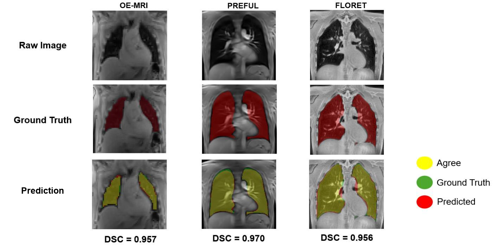
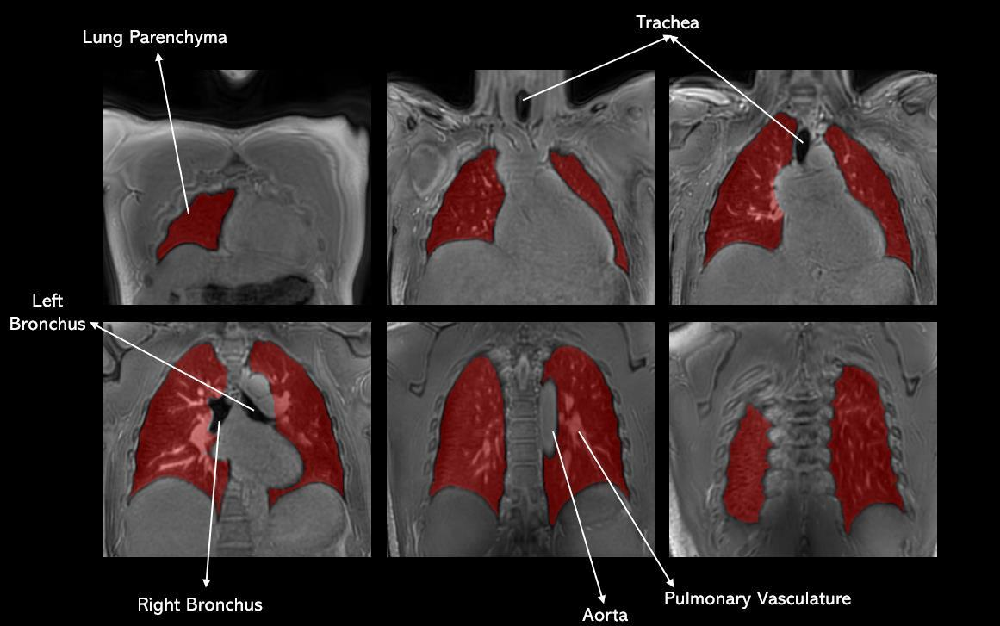
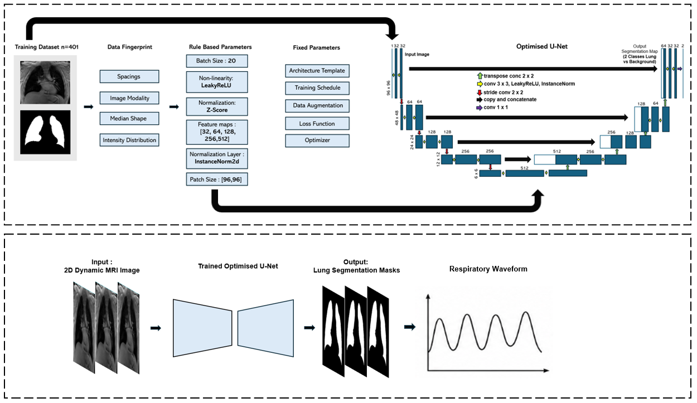
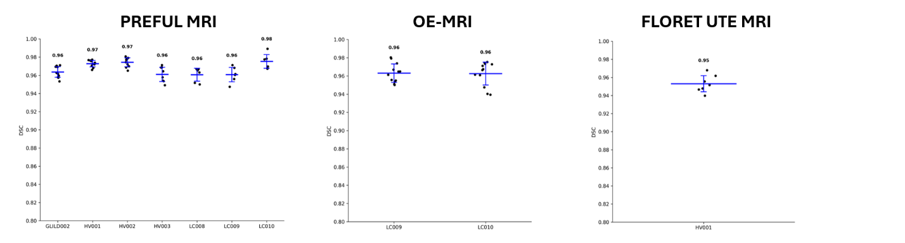

# Dynamic Lung Segmentation with nnU-Net

2D nnU-Net model for lung segmentation in coronal proton lung MRI. Trained on OE-MRI, 2D PREFUL and FLORET UTE images from healthy volunteers and patients (long COVID, GLILD).

Masks were manually refined using an annotation protocol developed with two thoracic radiologists, each with over 15 years of experience.



## Repo

- `weights/` – trained model (`PREFUL_OEMRI_lung_nnunet_v1.zip`, 58 MB)
- `examples/` – two images each from PREFUL, FLORET UTE and OE-MRI, plus the model output for them
- `scripts/` – DICOM to NIfTI converter and a viewer for checking masks
- `docs/` – figures

Training and test images are available upon request: bensii125@gmail.com

## How to run

Needs Python 3.10+ and [PyTorch](https://pytorch.org/get-started/locally/). Runs fine on CPU.

**1. Get the repo**

```bash
git clone https://github.com/bensii8511/Dynamic-Lung-Segmentation-nnU-Net.git
```

```bash
cd Dynamic-Lung-Segmentation-nnU-Net
```

or Code → Download ZIP.

**2. Install nnU-Net**

```bash
pip install nnunetv2==2.6.2
```

**3. Set the nnU-Net results folder** (any empty folder)

Linux / macOS:

```bash
export nnUNet_results="/path/to/nnUNet_results"
```

Windows (PowerShell):

```powershell
$env:nnUNet_results = "C:\path\to\nnUNet_results"
```

**4. Install the weights**

```bash
nnUNetv2_install_pretrained_model_from_zip weights/PREFUL_OEMRI_lung_nnunet_v1.zip
```

**5. Run on the examples**

```bash
nnUNetv2_predict -i examples/input -o my_output -d 8511 -c 2d -f all
```

Add `-device cpu` if there is no GPU. Output should match `examples/expected_output`. The warning about `nnUNet_raw` / `nnUNet_preprocessed` not being set can be ignored.


## Your own data

One 2D coronal slice per NIfTI file, all in one folder, with `_0000` at the end of the name (nnU-Net needs this):

```
subject01_frame001_0000.nii.gz
subject01_frame002_0000.nii.gz
```

- Dynamic series: one file per time frame.
- 3D volumes: one file per coronal slice.
- Voxel spacing in the header has to be correct, nnU-Net resamples using it.
- Keep the same orientation as the files in `examples/input` for that acquisition type.

Output mask: 0 = background, 1 = lung.

## Scripts

Need `pip install pydicom nibabel matplotlib`.

Convert a DICOM folder to a NIfTI volume (works with files that have no extension, 3D, 4D and multi-frame DICOM):

```bash
python scripts/dcm_to_nifti.py path/to/dicom_folder output.nii.gz
```

Scroll through images with the mask overlaid, to check the segmentations:

```bash
python scripts/view_masks.py examples/input examples/expected_output
```

Scroll or left/right arrows to change case, up/down arrows to change slice.

## Dataset

401 2D images, 12 participants, 3T.

| | OE-MRI | PREFUL | FLORET UTE |
|---|---|---|---|
| Scanner | Philips Ingenia | Philips Ingenia | Philips Achieva |
| Sequence | 2D SPGR | 2D SPGR | 3D spiral UTE |
| Acquisition | Dynamic, free breathing | Dynamic, free breathing | Static |
| In-plane resolution | 4.7 × 4.7 mm | 2 × 2 mm | 1 × 1 mm |
| Slice thickness | 10 mm | 15 mm | 1 mm |
| Matrix | 96 × 96 | 240 × 240 | 384 × 384 × 384 |

OE-MRI and PREFUL frames were picked randomly across the time series to cover the breathing cycle. FLORET UTE volumes were split into coronal slices, posterior to anterior.

Masks were made in 3D Slicer (threshold, then manual correction):

- aorta excluded
- small pulmonary vessels included
- smooth contour at the lung–heart boundary, heart excluded
- trachea and main bronchi excluded



## Training

nnU-Net v2, `2d`, default trainer and plans. Patch size 96 × 96, batch size 20, 1000 epochs, trained on all 401 images (`-f all`). Took about 1 h 42 min on an RTX 5090.



To retrain:

```bash
nnUNetv2_plan_and_preprocess -d 8511 --verify_dataset_integrity
```

```bash
nnUNetv2_train 8511 2d all
```

## Results

Dice on 91 held-out images (not used in training):

| Acquisition | Participants | Slices | Mean DSC | SD |
|---|---|---|---|---|
| PREFUL | 3 healthy, 3 long COVID, 1 GLILD | 60 | 0.967 | 0.007 |
| OE-MRI | 2 long COVID | 24 | 0.963 | 0.012 |
| FLORET UTE | 1 healthy | 7 | 0.953 | 0.010 |



## Notes

- Only tested on data from one site.
- FLORET UTE is one participant in training and one in testing, so less reliable there.
- 2D model, each slice is segmented on its own. Slightly worse on the most anterior and posterior slices.
- Research use only.

## Acknowledgements

Supervised by Dr Mina Kim and Dr Yohn Taylor (UCL Medical Physics and Biomedical Engineering). Built with [nnU-Net](https://github.com/MIC-DKFZ/nnUNet).

## Contact

Ben Sii – bensii125@gmail.com
